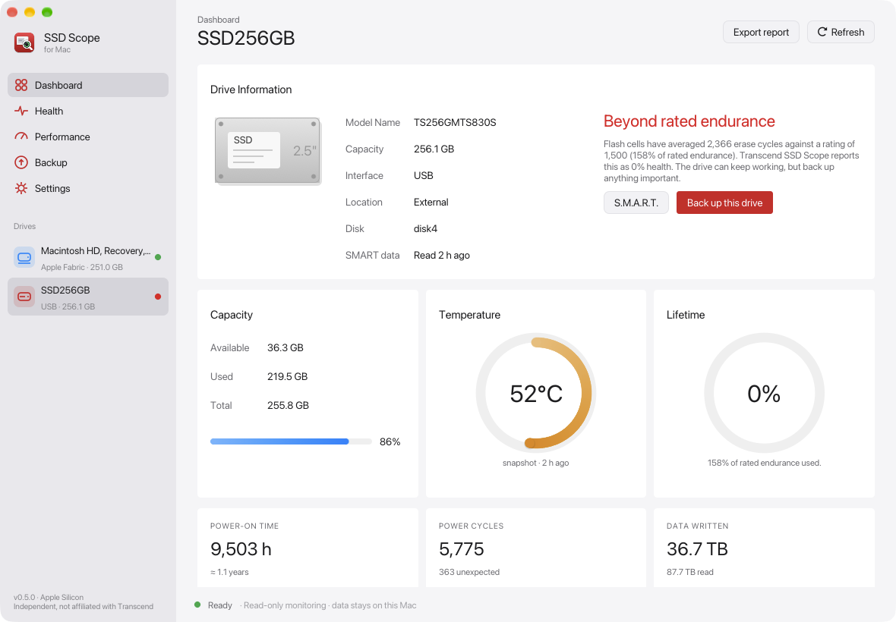
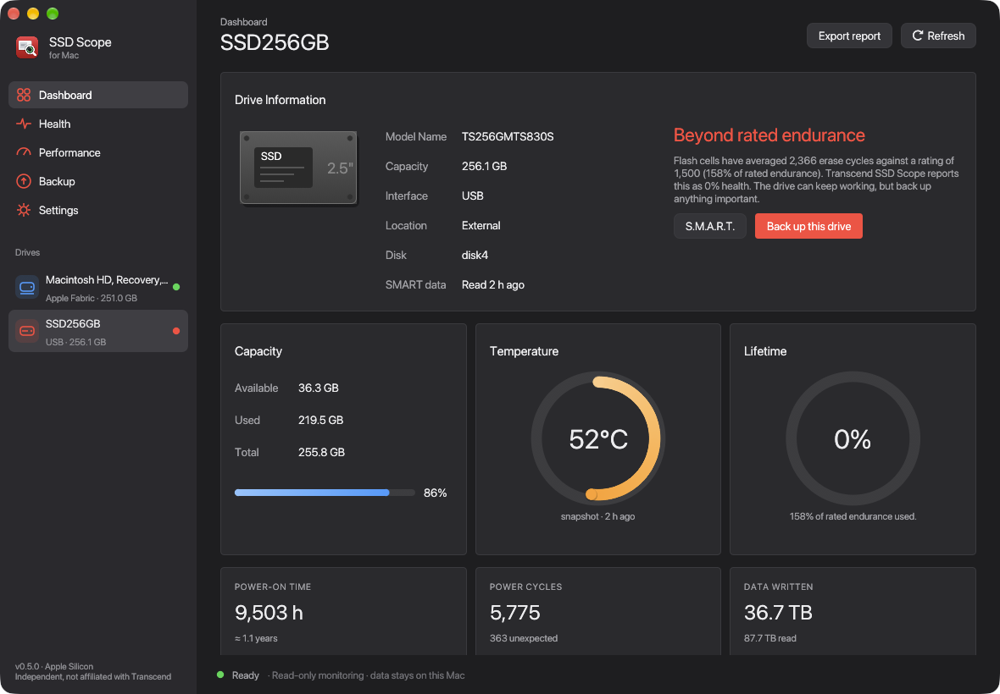
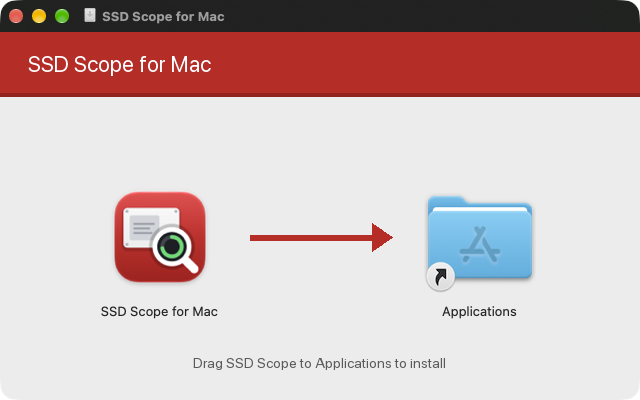

<p align="center"></p>

# SSD Scope for Mac

SSD Scope for Mac is a native Rust storage dashboard for Apple Silicon Macs, including M4. It has a
macOS-style interface:

- Drive information
- Capacity, temperature and lifetime gauges
- S.M.A.R.T. attributes
- Live read/write activity
- A speed test and verified file backups

The interface is available in English and Thai (ภาษาไทย).

> Independent open-source project. It is not affiliated with or endorsed by Transcend Information, Inc.
> "Transcend" and "SSD Scope" are trademarks of their owner and are used here only to describe compatibility.



<details><summary>Dark mode</summary>



</details>

<details><summary>ภาษาไทย</summary>


</details>

## Install

1. Download `SSD-Scope-for-Mac-0.5.1-arm64.dmg`.
2. Open it and drag **SSD Scope for Mac** into **Applications**.



The first time the app shows an external drive, macOS asks for permission to access removable
volumes. The app is signed with a stable identity, so macOS remembers your answer across updates.
Builds that are not notarized need **right-click → Open** the first time.

## Health: how the percentage is calculated

The health figure uses the same formula as Transcend SSD Scope for Windows. The formula was found by
inspecting `SSDScopeApp.exe` with [REA](https://github.com/morluto/rea); no code was copied.

| Drive type | Health |
| --- | --- |
| Controller reports a health value directly (e.g. JMicron attribute 0xAD) | that value |
| NVMe | 100 − *Percentage Used* |
| SATA | (rated erase cycles − *Average Erase Count*) ÷ rated erase cycles × 100, clamped to 0–100 |

For SATA drives, the *Average Erase Count* comes from attribute 0xA7. The rated erase cycles come from
attribute 0xA8 or 0xF5 (*Max Erase Count of Spec*). SSD Scope assumes 3000 when that attribute is missing.

**0% does not mean the drive has failed.** It means the flash has used up its rated erase cycles. For
example, a drive with an average of 2,366 erases against a rating of 1,500 is at 158% of its rated
endurance, so it shows 0%. Such a drive can keep working for a while, but back up anything important.

## Which drives can be read live

| Drive | Live SMART (temperature, health) | How it is read |
| --- | --- | --- |
| Mac internal SSD | ✅ Yes | Automatically. No password needed. |
| NVMe SSD in a Thunderbolt / USB4 enclosure | ✅ Yes¹ | Automatically. No password needed. |
| SATA or NVMe SSD in a USB enclosure | ❌ No | **Health → Read SMART now**: unmount, password, saved reading |
| SATA SSD in a Thunderbolt enclosure | ❌ No | Same as a USB enclosure (it sits behind a SATA bridge) |

Internal and Thunderbolt NVMe drives appear to macOS as native NVMe devices. Their SMART data
is read with the user's normal permissions. This was tested with the internal Apple SSD (AP0256Z):

- temperature
- *Percentage Used*, from which health is calculated
- overall status

¹ The enclosure must be connected to a Thunderbolt or USB4 port with a Thunderbolt/USB4 cable.
Many enclosures (for example those using the ASMedia ASM2464PD chip) fall back to USB mode on
other ports or cables. In USB mode the USB limits below apply. No Thunderbolt enclosure has been
tested with this app yet.

## USB enclosures

Windows SSD Scope reads SMART from USB drives through the Windows `DeviceIoControl` pass-through.
macOS has no equivalent for a mounted USB (UAS) drive. The only alternatives are a kernel extension,
which needs reduced security, or a DriverKit driver, which needs special Apple entitlements.
This app uses neither, so Full Security stays on.

Instead, **Health → Read SMART now** reads SMART in one click:

1. It unmounts the drive normally. It never forces an unmount.
2. A separate helper reads SMART over USB (BOT/SAT) after you enter your administrator password.
3. The drive mounts again, and the reading is saved with its time.

The reading is shown in the app and the menu bar until you take a new one. The app must run from
**Applications**, not from the drive being read.

Before you read, quit apps and Terminal windows that have files or folders open on the drive.
If the unmount fails, the app lists them. Each step of the last read is written to
`~/Library/Application Support/SSD Scope/last-smart-read.log`. The log contains steps and errors
only, with no SMART values or serial numbers.

The tested enclosure is a Transcend TSD302 with a Realtek RTL9201 bridge (0bda:9201) and a TS256GMTS830S SSD.
See [USB SMART](docs/USB-SMART.md) and [direct USB capture](docs/DIRECT-USB.md).

## Features

- Dashboard: drive information, capacity, temperature, lifetime, power-on time, power cycles and data written.
- Health: endurance bar, a S.M.A.R.T. attribute table with explanations, and the source of each reading.
- Performance: a live read/write chart with hover details, and a speed test on a temporary file.
- Backup: copies files into a new folder, verifies them with SHA-256 and restores them into another new folder.
- Menu bar icon showing free space, activity or temperature.
- Appearance: system (default), light or dark. Language: automatic, English or Thai.

Firmware updates, secure erase, TRIM, raw disk writes and disk cloning are intentionally not implemented.

## Build

You need macOS 14 or later, the Xcode Command Line Tools and stable Rust.

```sh
./scripts/cargo.sh test --release --locked --features experimental-usb
./scripts/package.sh            # app, ZIP and drag-to-Applications DMG in ../dist
```

`package.sh` signs the app with the first Developer ID Application or Apple Development identity it
finds. To choose one, set `SIGN_IDENTITY`. If no identity is available, it falls back to an ad-hoc
signature; with an ad-hoc signature, macOS asks for volume access again after every rebuild.

## Tests and security

```sh
./scripts/cargo.sh clippy --release --locked --features experimental-usb --all-targets -- -D warnings
./scripts/cargo.sh fmt -- --check
```

The 49 tests cover:

- corrupted data and cancellation
- command and path injection, symlink substitution and path containment
- private file permissions and cleanup
- the SMART and USB protocol parsing
- the Windows health formula

Tests write only to temporary directories they own. See [SECURITY.md](SECURITY.md) and [validation](docs/VALIDATION.md).

## License

The Rust source code and the icon are released under the [MIT License](LICENSE).

The bundled components keep their own licenses:

- `smartctl` (smartmontools 7.5) is a separate GPL-2.0-or-later program.
- `libusb` 1.0.30 is LGPL-2.1-or-later and is dynamically linked.

The exact sources for both are included in the app bundle.

No Transcend code, binaries, logos or installer files are included. Transcend's GPL System Clone
(ODIN) source was reviewed but not used.

See [THIRD_PARTY_NOTICES.md](THIRD_PARTY_NOTICES.md) and [SOURCE_PROVENANCE.md](SOURCE_PROVENANCE.md).
